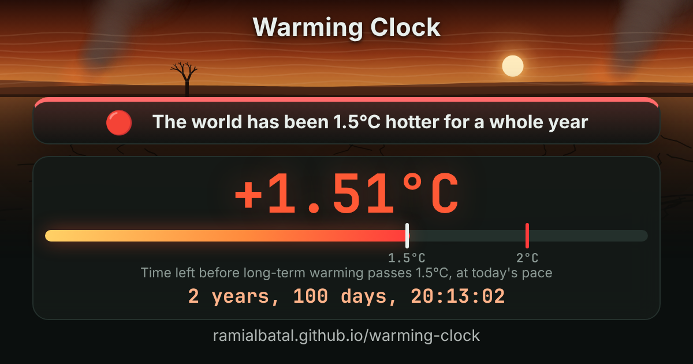

# Warming Clock



**Live site: https://ramialbatal.github.io/warming-clock/**

How much hotter the world is than before industry, from the latest official temperatures, next to the Paris limits of
1.5°C and 2°C, with a live countdown to when long-term warming passes the next one at today's pace. It answers one
question first, in plain words: how close are we to the 1.5°C limit?

**Languages:** English, French, Spanish and Arabic. The globe at the top switches language; `?lang=fr`, `?lang=es` or
`?lang=ar` opens one directly. Translations live in `js/i18n/`; corrections from native speakers are very welcome.

**What can I do?** A button under the answer opens three evidence-based actions, each with its source (`js/actions.js`).

**Privacy:** visits are counted anonymously with [GoatCounter](https://www.goatcounter.com/) (no cookies, no
personal data). The link-preview picture (`img/og-image.png`) is refreshed every Monday by a GitHub Action
(`npm run og-image`), so shared links show that week's answer and number.

**On your own website:** "Add to your site" at the top gives a one-line code for a small live widget (the answer and
the temperature), in the language you have open. The widget is the same page with `?embed=1`.

Serve the folder with any static server (`npm run serve`, then open http://localhost:8000) or any static host. There's
no build step. Opening `index.html` straight from disk won't work: browsers block ES modules on `file://` pages.

## Data

All fetched live in the browser from [Our World in Data](https://ourworldindata.org/climate-change):

| What | Source | Notes |
|---|---|---|
| World temperature, monthly | [Copernicus Climate Change Service, ERA5](https://climate.copernicus.eu/) | Surface air temperature, difference from the 1991-2020 average |
| Country temperatures, yearly | Copernicus ERA5 | Each country against its own 1991-2020 average |
| Pre-industrial offset | [Copernicus](https://climate.copernicus.eu/climate-bulletin-about-data-and-analysis) | 1991-2020 was 0.88°C warmer than 1850-1900; typed into `js/config.js` |

## Method

- **Recent warming** = the average of the last 12 months, plus 0.88°C (the same offset Copernicus uses).
- **Long-term warming** = a straight line (least squares) through the last 30 complete years, read today. The Paris
  limits refer to long-term averages, so this smooths out El Niño years.
- **Countdown** = when that line reaches the next Paris limit, assuming warming keeps its current pace.
- **Countries** = the latest complete year against each country's own 1991-2020 normal.

## Run it and check it

```sh
npm run serve        # then open http://localhost:8000
npm install          # dev tools only: TypeScript checker, Playwright, clock-core (types and tests)
npm run check        # house style + types + unit tests
npx playwright install chromium   # once, for the smoke test
npm run smoke        # real browser, real data, desktop and phone, every language and the widget
```

Settings live in `js/config.js`, calculations in `js/model.js` (unit tested), page code in `js/app.js`, the picture behind the header in `js/scene.js`. Shared helpers
and styles come from [clock-core](https://github.com/ramialbatal/clock-core), pinned to an exact commit in `index.html` and `package.json`.
How the clocks are built, lessons learned and rules for new code: [developer notes](https://github.com/ramialbatal/clock-core/tree/main/docs).

## Contributing

Issues and pull requests are welcome: see [CONTRIBUTING.md](CONTRIBUTING.md).

## Licence

Code: [MIT](LICENSE). Data: Copernicus Climate Change Service (free to use, with attribution), via Our World in Data
(CC BY 4.0).
